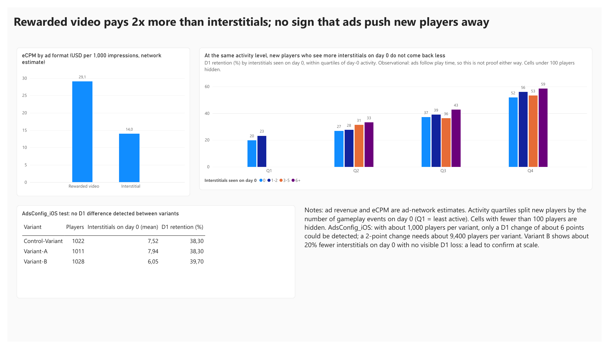
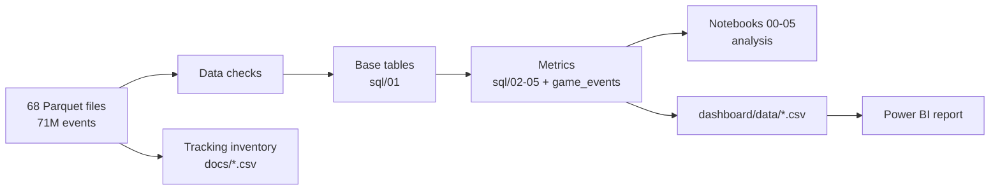

# Game Event Analytics

[](https://github.com/DJ-Papy/game-event-analytics/actions/workflows/ci.yml)

**Scenario.** The live-ops team of a free-to-play mobile game wants to know where new players are lost, and whether ads drive them away, before changing the ad configuration.
**Data.** 71 million events of a real mobile game over six weeks (public Kaggle dataset), analysed with SQL (DuckDB on Parquet) and Python, reported in Power BI.

**Dashboard (2 pages):** [`docs/dashboard.pdf`](docs/dashboard.pdf) · [One-page summary](docs/summary.md) · [Tracking plan](docs/tracking_plan.md)




## Recommendations

1. **Decide on ad frequency with a properly sized test, not with this data.** At the same level of play, new players who see more interstitials come back as often or slightly more: nothing shows that ads drive them away, but exposure also follows play time, so this is not proof either way.
2. **Re-run the `AdsConfig_iOS` test at scale.** With about 1,000 players per variant it could only detect a 6-point change in D1. A 2-point change needs about 9,400 players per variant.
3. **Fix the tracking before the next analysis.** Purchases are recorded on Android only, 10.4% of events have no session id, the ad revenue property was renamed mid-window, and one day of data is missing ([tracking plan](docs/tracking_plan.md)).

## Key results

- **New players drop off from one day to the next, not in the core progression.** 94.5% reach the first new zone, but only 37.0% come back the next day, 6.7% after 7 days and 2.9% after 14 days (about 44,000 players at D1, 95% CI 36.6–37.5%).
- **iPhone retains slightly better than Android** at D1 (40.5% vs 35.6%) and D7 (7.5% vs 6.4%); the gap is within the margin of error at D14.
- **Rewarded video earns about twice as much per impression as interstitials** (about $29 vs $14 per 1,000 impressions, ad-network estimate); about $0.23 of ad revenue per active player per day.
- **`AdsConfig_iOS`: no retention difference detected** (D1 38.3% / 38.3% / 39.7%). Variant B shows about 20% fewer interstitials on the first day, a lead to confirm.

## How the analysis is built



Every definition is written once, in `sql/` or in the `game_events` package, and used by both the notebooks and the dashboard export. The pipeline stops if a data check fails.

| Decision | Reason |
|---|---|
| A new player is a player with a `firstOpen` event in the window | the window starts in the middle of the game's life: "first seen" would include older players |
| Retention only on cohorts whose day N is observed, never on 2025-03-27 | missing data would be read as churn |
| An active day is any event, checked against "a session was opened" | server-side events alone add 6 players at D1; the 2.1-point gap with the stricter definition comes from sessions that continue past midnight |
| Ad exposure compared within quartiles of first-day activity | players who play more see more ads and come back more |
| Wilson and Newcombe intervals, bootstrap for revenue per player | small groups, rates near 0, skewed revenue |
| Purchase rate measured on Android players only (2.1%) | purchases are not tracked on iPhone |

## Limitations

- Six weeks of data: no long-term retention, no seasonality.
- 27 March shows an unexplained drop in active players (about 1,400 vs 3,500–4,500); it is excluded from retention and its cause is not established.
- One Parquet file (`part-00049`) is truncated in the source dataset and skipped.
- Ad revenue is a network estimate; its level shifts by about 27% when the property was renamed (`value` to `amount`) in late March. Whether this is a real or a measurement change is not established.
- Exposure vs retention is observational and confounded by play volume.

## Repository

```
src/game_events/   package: data access, checks, metrics, A/B statistics, exports
sql/               core definitions (base tables, retention, funnel, exposure, experiment)
notebooks/         analysis, one question per notebook
tests/             unit and end-to-end tests on generated data, run by CI on every push
dashboard/         Power BI report and the CSV files it reads
docs/              summary, tracking plan, event inventory, dashboard export
data/              data source and download instructions (raw files are not committed)
```

## Run it

```powershell
python -m venv .venv
.venv\Scripts\Activate.ps1
pip install -e ".[notebooks,dev]"
# download the Parquet files into data/raw/player_analytics/ (see data/README.md)
python -m game_events build        # data checks, then dashboard/data/*.csv
python -m game_events inventory    # docs/*.csv for the tracking plan
pytest                             # tests (no data needed)
jupyter lab                        # notebooks 00 to 05
```

The Power BI report `dashboard/game-event-analytics.pbix` reads the CSV files from `P:\`: on Windows, run `subst P: "<path to dashboard\data>"` first, or edit the source path in Power Query.

## Data and licence

Kaggle, *Player Analytics Event Stream Data*, licence CC BY 4.0 as stated on the Kaggle page when the data was downloaded (2026-11-01). Only aggregated tables and documentation are published here. Details in [`data/README.md`](data/README.md).
