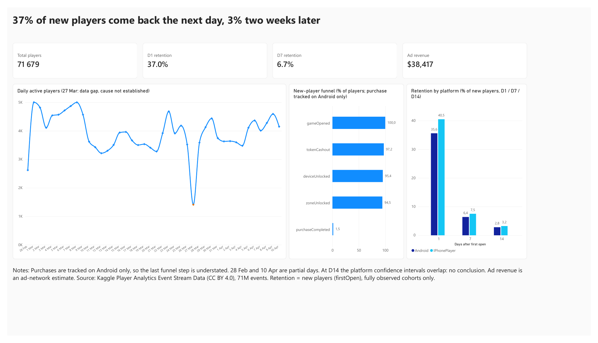

# Game Event Analytics

Where do new players of a mobile game drop off, and does advertising help or hurt their return?
About 71 million events analysed with SQL (DuckDB, reading Parquet directly) and Python, with a one-page Power BI dashboard and a tracking plan.

**Dashboard:** [`docs/dashboard.pdf`](docs/dashboard.pdf) · Power BI file: `dashboard/game-event-analytics.pbix` · [One-page summary](docs/summary.md) · [Tracking plan](docs/tracking_plan.md)



## Key findings

- **New players drop off from one day to the next, not in the core progression.** 94.5% of new players reach the first new zone, but only 37.0% come back the next day, 6.7% after 7 days and 2.9% after 14 days (about 44,000 players at D1, 95% CI 36.6–37.5%).
- **iPhone retains slightly better than Android** at D1 (40.5% vs 35.6%) and D7 (7.5% vs 6.4%); the gap is within the margin of error at D14.
- **Ad exposure and retention move together, but this is not causal.** Heavy players see more ads and return more. Within activity quartiles the gap shrinks a lot.
- **Rewarded video earns about twice as much per impression as interstitials** (about $29 vs $14 per 1,000 views, ad-network estimate).
- **The existing A/B test (AdsConfig_iOS) is underpowered** (about 1,000 players per variant): D1 38.3% / 38.3% / 39.7%, no conclusion. Detecting a 2-point change would need about 9,400 players per variant.

## Method

| Step | Notebook |
|---|---|
| Load Parquet files, check quality | `notebooks/00_load_and_quality.ipynb` |
| Sessions, funnel | `notebooks/01_sessions_and_funnel.ipynb` |
| Cohort retention (Wilson intervals) | `notebooks/02_cohort_retention.ipynb` |
| Ad monetisation, exposure vs retention | `notebooks/03_ad_monetisation.ipynb` |
| Event inventory, tracking plan | `notebooks/04_tracking_inventory.ipynb` |
| A/B test analysis, power analysis | `notebooks/05_ab_test_ads_config.ipynb` |
| Aggregated tables for the dashboard | `scripts/export_dashboard_data.py`, using the queries in `sql/` |

Choices that matter: a session is a `user_session_id`; new players are players with a `firstOpen` event; retention is computed only on cohorts whose target day is fully observed (last full day 2025-04-09) and never on the data gap of 2025-03-27; the day-0 activity of a player is used to control the ad-exposure comparison.

The core definitions (new players, active days, retention, new-player funnel, first-day ad exposure) are written once in [`sql/`](sql/) and run by the export script, so the dashboard uses the SQL shown in the repository.

## Limitations

- Six weeks of data: no long-term retention, no seasonality.
- 27 March shows an unexplained drop in active players (about 1,400 vs 3,500–4,500); it is excluded from retention and its cause is not established.
- One Parquet file (`part-00049`) is truncated and skipped.
- 10.4% of events have no session id and are excluded from session metrics.
- Purchases are tracked on Android only: the purchase step of the funnel is also measured on Android new players alone, and no purchase rate can be given for iPhone players.
- Ad revenue is a network estimate; its level shifts by about 27% when the field was renamed (`value` to `amount`) in late March. Whether this is a real or a measurement change is not established.
- Exposure vs retention is observational and confounded by play volume.

## How to run

```powershell
python -m venv .venv
.venv\Scripts\Activate.ps1
pip install -r requirements.txt
# download the Parquet files into data/raw/player_analytics/ (see data/README.md)
jupyter lab                                 # run notebooks 00 to 05 in order
python scripts/export_dashboard_data.py     # runs sql/ and writes dashboard/data/*.csv
```

Then open `dashboard/game-event-analytics.pbix` in Power BI Desktop (the CSV files in `dashboard/data/` are its source). The queries read them from `P:\`; on Windows, run `subst P: "<path to dashboard\data>"` first, or edit the source path in Power Query.

## Structure

```
data/            data source notes (raw files are not committed)
sql/             core definitions: base tables, retention, funnel, first-day ad exposure
notebooks/       analysis, one notebook per question
scripts/         Parquet loader, dashboard export
dashboard/       Power BI file and its aggregated CSV sources
docs/            dashboard (PDF, PNG), summary, tracking plan, event inventory
```

## Data and licence

Kaggle, *Player Analytics Event Stream Data*, licence CC BY 4.0 as stated on the Kaggle page when the data was downloaded (2026-11-01). Details in [`data/README.md`](data/README.md).
